  

<h1 align="center">VialFX 1.1</h1>

<em>Two filters, a nine-effect rack and a spectral engine, driven by two audio inputs. Free and open source (GPLv3).</em>

VialFX is an audio effect plugin (VST3) with a main input and a sidechain input. Each input can be warped, spectrally morphed and routed to the filters, the effects rack or straight to the output.

## Changelog

**New in 1.1**

- **Skin Editor, rebuilt.** Colours are grouped into "bins" (Global, Filters, Effects and more), each with its own colour rows, a colour picker, undo/redo, a **Default** button that fully resets the skin, and save/import of `.vialskin` files. The editor window stays on top and can be resized.
- **Per-effect skin bins.** Every effect module (Chorus, Compressor, Delay, Distortion, EQ, Filter, Flanger, Phaser, Reverb) has its own sub-bin under Effects, so you can colour each one separately.
- **Hover outline.** A dashed outline shows which bin a part of the interface belongs to. Alt-click it to jump straight to that bin in the editor.
- **Glow.** A full-screen, colour-keyed bloom that can be applied to any colour, with a **Glow Strength** and a **Glow Size** knob on each, per bin.
- **Gradients.** Any colour value can become a gradient with up to three stops and an angle.
- **Smoother live editing.** Skin changes while dragging colours or knobs are throttled and no longer make the plugin window flicker.
- **Free-form resizing.** VialFX can be resized to any shape, and the shape is remembered.
- **Two spectral curve editors at once.** Split view now has one curve editor per lane, so the main input and the sidechain can each have their own (for example Spectral Filter on the input and Spectral Flanger on the sidechain).
- **Effects rack.** Double-click an effect to minimize or expand it. A new selection mode lets you pick several effects to duplicate or delete at once. The X button is gone from expanded effects.
- **Installers.** A Windows installer (`.exe`) and a macOS installer (`.pkg`) now ship alongside the VST3 zips.

**Fixed**

- Initialize now closes any open morph menus.
- Loading the default skin now resets everything instead of leaving some colours behind.
- The value -/+ buttons in the editor now change the value.

## Highlights

- **Two inputs, flexible routing.** Main and sidechain lanes with live spectrum displays, each routable to Filter 1, Filter 2, both, the effects, or direct out. The sidechain can modulate the main lane (FM, RM, Vocode) even with its level at zero.
- **Distortion warp.** Sync, Formant, Quantize, Bend, Squeeze, Pulse, FM and RM, plus **Distort Table**: waveshaping driven by a built-in wavetable of 16 transfer curves.
- **Spectral morph.** An FFT stage with Formant Scale, Harmonic and Inharmonic Stretch, Smear, Random Amplitudes (with a dice button), Low/High Pass, Phase Disperse, Shepard Tone and Spectral Time Skew, plus a filterbank **Vocoder** and **Spectral Table**, a filter driven by a built-in wavetable of 16 frequency responses.
- **Drawable spectral modes.** Spectral Filter, Phaser and Flanger shaped by a curve you draw. Two curve editors can be open at once, one per lane.
- **Polyphonic key tracking.** Filter FX, Delay, Chorus, Flanger and Phaser run a per-note copy and crossfade the result.
- **Unlimited effects rack.** Chorus, Compressor, Delay, Distortion, EQ, Filter, Flanger, Phaser and Reverb, added in any order and as many times as you like. Drag to reorder, double-click to minimize, and select several to duplicate or delete.
- **Full modulation matrix.** LFOs, envelopes, randoms, macros and MIDI sources can drive nearly everything, including lane level and pan, filters, effects and the table and morph controls.
- **Skin Editor.** Edit every colour in grouped "bins", with a colour picker, gradients, per-colour glow strength and size, undo/redo, a hover outline that shows which part of the UI you are editing, and save/import of `.vialskin` files.
- **Resizable to any shape,** and the shape is remembered.

## Downloads

| Platform | File |
| --- | --- |
| Windows | `VialFX-1.1-Windows-Setup.exe` (installer) or the VST3 zip |
| macOS (Apple Silicon and Intel) | `VialFX-1.1-macOS.pkg` (installer) or the VST3 zip |
| Linux | VST3 zip |

The installers put VialFX in the standard system VST3 folder. After installing, rescan plugins in your DAW.

> **Note:** the builds are unsigned. Windows may show a SmartScreen warning (More info > Run anyway). On macOS, right-click the installer and choose Open the first time.

## Licence

GPLv3. VialFX is built from GPLv3 source code and does not connect to any web service. See the README and NOTICE.md for details.

## Acknowledgements

**Matt Tytel.** VialFX would not exist without him. It is built on the open-source synthesizer code he wrote and released under the GPLv3. His work on the audio engine, the modulation system and the interface gave this project a foundation far beyond what we could have built from scratch. Thank you for sharing that work openly so that others can learn from it and build on it. VialFX is an independent project and is not affiliated with or endorsed by him.

**-LightningPig** made the art for VialFX, including the logo you see at the top of this page. Thank you for giving the plugin its look.

**Every tester.** Thank you to everyone who installed early builds, reported bugs, sent screenshots and told us what felt wrong. Much of what is in 1.1 exists because of your feedback.
