  

<h1 align="center">VialFX 1.2</h1>

<em>Adds the Morph effect, CLAP support and a bevel creator in the skin editor. Free and open source (GPLv3).</em>

VialFX is an audio effect plugin (VST3 and CLAP) with a main input and a sidechain input. Each input can be warped, spectrally morphed and routed to the filters, the effects rack or straight to the output.

## Changelog

**New in 1.2**

- **Morph effect.** A new effect for the rack with the same spectral and distortion warp modes as the Voice tab's input and sidechain panels. It has no volume, pan or routing controls, and a compact, centred layout.
  - A spectral stage (Morph amount plus the spectral modes) and a distortion stage (warp type plus amount).
  - A **⇌ swap button** between the two dropdowns chooses which stage runs first.
  - **Random Amplitudes** has its dice and shuffle buttons.
  - **Drawable modes.** Spectral Filter, Phaser and Flanger have a curve editor, opened with the pencil button next to the mode selector.
  - **Table modes.** Spectral Table and Warp Table have a settings menu (gear button) and a wavetable editor (pencil button).
  - **Docked editors.** The editors dock directly below the Morph module. The effects list grows and everything below moves down, so nothing overlaps. A curve editor or spectral table menu and the warp table menu can be open together in a split view.
  - You can add several Morph copies, and each one has its own curves and tables.
  - Vocode, FM and RM are not available in Morph, because they need the sidechain.
  - Morph settings, curves and tables are saved in presets. Unused Morph copies save their tables as empty.
  - Reset and Copy on a Morph copy cover its knobs only, not its curves or table contents.
- **Spectral Gate.** A new spectral mode.
- **Swap button (⇌)** between the spectral and warp dropdowns, to swap the order the two stages run in.
- **CLAP.** VialFX is now also built as a CLAP plugin for Windows, macOS and Linux.
- **Installers with options.** The Windows installer (`.exe`) and the macOS installer (`.pkg`) let you choose VST3, CLAP or both.
- **Skin editor: Bevel creator.** A **BEVEL** button next to GRADIENT on every colour, global or per section, lights the rim of everything drawn in that colour like raised glass. **Size** sets the width of the rim, **Depth** how strongly it is lit (negative values press it in), **Gloss** adds a curved glassy sheen for aero and glossy looks, and **Light** sets the direction of the light. It works with or without a gradient, applies instantly and is saved in the skin.
- **Skin editor: Alt inspector.** Hold Alt over the plugin to inspect single elements, and Alt-click one to edit the colours it is drawn with.
- **Skin editor: Morph bin.** Morph has its own skin bin and a default violet colour.
- **Skin editor: resizing.** The editor window now scales down to fit small windows instead of cutting off.
- **Test builds** are marked NIGHTLY in the About box, with a link to the GitHub page. Stable releases such as this one carry no marker.

## Highlights

- **Two inputs, flexible routing.** Main and sidechain lanes with live spectrum displays, each routable to Filter 1, Filter 2, both, the effects, or direct out. The sidechain can modulate the main lane (FM, RM, Vocode) even with its level at zero.
- **Distortion warp.** Sync, Formant, Quantize, Bend, Squeeze, Pulse, FM and RM, plus **Distort Table**: waveshaping driven by a built-in wavetable of 16 transfer curves.
- **Spectral morph.** An FFT stage with Formant Scale, Harmonic and Inharmonic Stretch, Smear, Random Amplitudes (with a dice button), Low/High Pass, Phase Disperse, Shepard Tone and Spectral Time Skew, plus a filterbank **Vocoder**, **Spectral Gate** and **Spectral Table**, a filter driven by a built-in wavetable of 16 frequency responses.
- **Drawable spectral modes.** Spectral Filter, Phaser and Flanger shaped by a curve you draw, on the input and sidechain lanes and in every Morph effect.
- **Polyphonic key tracking.** Filter FX, Delay, Chorus, Flanger and Phaser run a per-note copy and crossfade the result.
- **Unlimited effects rack.** Chorus, Compressor, Delay, Distortion, EQ, Filter, Flanger, Morph, Phaser and Reverb, added in any order and as many times as you like. Drag to reorder, double-click to minimize, and select several to duplicate or delete.
- **Full modulation matrix.** LFOs, envelopes, randoms, macros and MIDI sources can drive nearly everything, including lane level and pan, filters, effects and the table and morph controls.
- **Skin Editor.** Edit every colour in grouped "bins", with a colour picker, gradients, bevels, per-colour glow strength and size, undo/redo, a hover outline that shows which part of the UI you are editing, and save/import of `.vialskin` files.
- **Resizable to any shape,** and the shape is remembered.

## Downloads

| Platform | File |
| --- | --- |
| Windows | `VialFX-1.2-Windows-Setup.exe` (installer, VST3 and/or CLAP) or the VST3 / CLAP zips |
| macOS (Apple Silicon and Intel) | `VialFX-1.2-macOS.pkg` (installer, VST3 and/or CLAP) or the VST3 / CLAP zips |
| Linux | VST3 and CLAP zips |

The installers put VialFX in the standard system VST3 and CLAP folders. After installing, rescan plugins in your DAW.

> **Note:** the builds are unsigned. Windows may show a SmartScreen warning (More info > Run anyway). On macOS, right-click the installer and choose Open the first time.

## Licence

GPLv3. VialFX is built from GPLv3 source code and does not connect to any web service. See the README and NOTICE.md for details.

## Acknowledgements

**Matt Tytel.** VialFX would not exist without him. It is built on the open-source synthesizer code he wrote and released under the GPLv3. His work on the audio engine, the modulation system and the interface gave this project a foundation far beyond what we could have built from scratch. Thank you for sharing that work openly so that others can learn from it and build on it. VialFX is an independent project and is not affiliated with or endorsed by him.

**-LightningPig** made the art for VialFX, including the logo you see at the top of this page. Thank you for giving the plugin its look.

**Every tester.** Thank you to everyone who installed early builds, reported bugs, sent screenshots and told us what felt wrong. Much of what is in 1.2 exists because of your feedback.
