  

<h1 align="center">VialFX 1.3</h1>

<em>Adds the Other filters, three new distortions, five more effects, point modulation and modulation-aware duplicating. Free and open source (GPLv3).</em>

VialFX is an audio effect plugin (VST3 and CLAP) with a main input and a sidechain input. Each input can be warped, spectrally morphed and routed to the filters, the effects rack or straight to the output.

## Changelog

**New in 1.3**

- **Other filters.** A new filter category in Filter 1, Filter 2 and every Filter effect copy. Cutoff, resonance, drive and the blend slider are used by every style, and **Drive** soft-clips the input ahead of the filter.
  - **Band Reject.** A notch whose width is the blend slider, from narrow to a very wide valley. Resonance lifts the two peaks beside the valley, like a phaser without the middle notches.
  - **All-Pass.** A resonant second-order phase shifter, with its phase in the display.
  - **Metal Comb.** A comb with inharmonic spacing: blend goes from a plain comb through metallic to very inharmonic. Cutoff is the pitch and resonance the feedback.
  - **Metal Reverb.** A small reverb tuned to inharmonic delay times. Blend is the size, resonance the decay and cutoff the tone of the tail (shown in the display).
  - **Disperser.** A chain of all-pass stages, 1 to 256 of them on the blend slider. Cutoff is the centre and resonance pinches the stages in towards it, from spread over eight octaves to all on the cutoff for a sharp, classic dispersion peak. The display shows the group delay.
  - **Custom.** Draw three response curves A, B and C. The three positions of the blend slider are the three frames, and a pencil button on the display switches to editing. Cutoff shifts the curves and resonance sets their depth. Each Filter effect copy has its own curves.
- **New distortions.** **Tube** (asymmetric, even harmonics), **Saturator** (smooth cubic) and **Overdrive** (exponential soft clip).
  - Overdrive has a **Stages** knob (1 to 8, with eight ticks around it) that runs the signal through that many clipping stages in a row. It can be modulated.
- **Five more effects** from the Vial bundle join the rack, each usable as many times as you like:
  - **Pitch Shifter.** Granular, multiband granular, retro and spectral engines with formant control.
  - **Utility.** Gain, pan, width, Haas, mono bass, phase invert, DC filter and a level meter.
  - **Freq Shifter**, **Vibrato** and **Tremolo**.
- **Modulate the points of drawn lines.** Drag a modulation source over an LFO shape or a spectral curve and every point shows an X and a Y target. Drop on one like on a knob and set the amount with the usual ring. Modulated points get a ring that follows where the modulation moves them. Up to 32 point targets per preset.
- **Duplicating an effect keeps its modulation.** The copy gets the same knob positions and the same modulation mappings (LFOs, macros, randoms and envelopes, with amount, polarity, stereo, bypass and mapping curve).
- **Effects list.** Right-click a row for Duplicate, Minimize or Remove, and select several effects by dragging over rows.
- **Fixes.** A macro's drag circle no longer gets stuck on screen after dragging. Loading a custom skin no longer stops **Load custom skin** from opening the file chooser.

**Also in 1.2**

- Morph effect, Spectral Gate, CLAP builds, installers with options, and the skin editor's bevel creator, Alt inspector and Morph bin.

## Highlights

- **Two inputs, flexible routing.** Main and sidechain lanes with live spectrum displays, each routable to Filter 1, Filter 2, both, the effects, or direct out.
- **Distortion warp and spectral morph,** with drawable spectral modes, a Vocoder, Spectral Gate and Spectral Table.
- **Unlimited effects rack** of fifteen effect types, added in any order and as many times as you like.
- **Full modulation matrix.** LFOs, envelopes, randoms, macros and MIDI sources can drive nearly everything, now including the points of drawn lines.
- **Skin Editor** with gradients, bevels and glow, and **resizable** to any shape.

## Downloads

| Platform | File |
| --- | --- |
| Windows | `VialFX-1.3-Windows-Setup.exe` (installer, VST3 and/or CLAP) or the VST3 / CLAP zips |
| macOS (Apple Silicon and Intel) | `VialFX-1.3-macOS.pkg` (installer, VST3 and/or CLAP) or the VST3 / CLAP zips |
| Linux | VST3 and CLAP zips |

The installers put VialFX in the standard system VST3 and CLAP folders. After installing, rescan plugins in your DAW.

> **Note:** the builds are unsigned. Windows may show a SmartScreen warning (More info > Run anyway). On macOS, right-click the installer and choose Open the first time.

## Licence

GPLv3. VialFX is built from GPLv3 source code and does not connect to any web service. See the README and NOTICE.md for details.

## Acknowledgements

**Matt Tytel.** VialFX would not exist without him. It is built on the open-source synthesizer code he wrote and released under the GPLv3. His work on the audio engine, the modulation system and the interface gave this project a foundation far beyond what we could have built from scratch. Thank you for sharing that work openly so that others can learn from it and build on it. VialFX is an independent project and is not affiliated with or endorsed by him.

**-LightningPig** made the art for VialFX, including the logo you see at the top of this page. Thank you for giving the plugin its look.

**Every tester.** Thank you to everyone who installed early builds, reported bugs, sent screenshots and told us what felt wrong. Much of what is in 1.3 exists because of your feedback.
