  

<h1 align="center">VialFX 1.4.2</h1>

<em>AU for macOS and LV2 for Linux, plus the 1.4.1 searchable modulation matrix menus. Free and open source (GPLv3).</em>

VialFX is an audio effect plugin (VST3 and CLAP) with a main input and a sidechain input. Each input can be warped, spectrally morphed and routed to the filters, the effects rack or straight to the output.

## Changelog

**New in 1.4.2**

- **Audio Unit (AU) for macOS.** A universal (Apple silicon and Intel) VialFX.component, also an option in the macOS installer and available as a zip.
- **LV2 for Linux.** A VialFX.lv2 bundle as a zip. Both new formats are lightly tested in real hosts; please report problems.

**Also in 1.4.1**

- Searchable modulation matrix menus (type to search every entry), a grouped source menu, and destination sections for Pitch Shifter, Utility, Freq Shifter, Vibrato, Tremolo, Morph, Macros and Point Mods.

**Also in 1.4**

- FX Bins, Parallel Split, 64 host automation slots, up to 32 LFOs, 32 envelopes and 16 randoms, up to 32 copies of every effect, undo/redo, and a fix for the crash when adding a ninth effect copy.

## Highlights

- **Two inputs, flexible routing.** Main and sidechain lanes with live spectrum displays, each routable to Filter 1, Filter 2, both, the effects, or direct out.
- **Distortion warp and spectral morph,** with drawable spectral modes, a Vocoder, Spectral Gate and Spectral Table.
- **Large effects rack** of fifteen effect types, added in any order, up to 32 copies each, and grouped into bins or parallel paths.
- **Full modulation matrix.** LFOs, envelopes, randoms, macros and MIDI sources can drive nearly everything, now including the points of drawn lines.
- **Skin Editor** with gradients, bevels and glow, and **resizable** to any shape.

## Downloads

| Platform | File |
| --- | --- |
| Windows | `VialFX-1.4.2-Windows-Setup.exe` (installer, VST3 and/or CLAP) or the VST3 / CLAP zips |
| macOS (Apple Silicon and Intel) | `VialFX-1.4.2-macOS.pkg` (installer, VST3 and/or CLAP) or the VST3 / CLAP zips |
| Linux | VST3 and CLAP zips |

The installers put VialFX in the standard system VST3 and CLAP folders. After installing, rescan plugins in your DAW.

> **Note:** the builds are unsigned. Windows may show a SmartScreen warning (More info > Run anyway). On macOS, right-click the installer and choose Open the first time.

## Licence

GPLv3. VialFX is built from GPLv3 source code and does not connect to any web service. See the README and NOTICE.md for details.

## Acknowledgements

**Matt Tytel.** VialFX would not exist without him. It is built on the open-source synthesizer code he wrote and released under the GPLv3. His work on the audio engine, the modulation system and the interface gave this project a foundation far beyond what we could have built from scratch. Thank you for sharing that work openly so that others can learn from it and build on it. VialFX is an independent project and is not affiliated with or endorsed by him.

**-LightningPig** made the art for VialFX, including the logo you see at the top of this page. Thank you for giving the plugin its look.

**Every tester.** Thank you to everyone who installed early builds, reported bugs, sent screenshots and told us what felt wrong. Much of what is in 1.4.2 exists because of your feedback.
