  

<h1 align="center">VialFX 1.4</h1>

<em>Adds FX Bins, Parallel Split, 64 host automation slots, undo/redo and far more modulators and effect copies. Free and open source (GPLv3).</em>

VialFX is an audio effect plugin (VST3 and CLAP) with a main input and a sidechain input. Each input can be warped, spectrally morphed and routed to the filters, the effects rack or straight to the output.

## Changelog

**New in 1.4**

- **FX Bins.** Group two or more effects into a bin from the button or the right-click menu. Rename a bin by clicking its title, collapse it with a double click or minimize (the sidebar collapses too), and use its power toggle and mix knob. Select effects that are not next to each other and they move into the bin together, keeping their order. Drag rows back out of a bin to leave it.
- **Parallel Split.** A new effect that runs as many parallel paths as you like, picked with an EQ-band-style selector and a + button (it scrolls when it overflows). Each path has gain, pan, mute and solo, a level meter and a dry/wet. Bins and Parallel Splits nest in each other to any depth.
- **Host automation slots.** The host now sees bypass plus 64 assignable Automation slots. Right-click any parameter and hover **Host Automation Slot** to assign it. **Manage Automation Slots** shows what every slot controls and lets you clear one or all.
- **Far more modulators.** 32 LFOs, 32 envelopes and 16 random LFOs with a scrolling tab row, plus 8 macros with an expandable second column. Presets from earlier versions still load.
- **Up to 32 copies of every effect type.** Copies beyond the first eight are built the first time they are added, so startup stays fast and unused copies cost almost no memory. Older presets are converted automatically.
- **Undo and redo.** Buttons left of Save step through parameter, modulation and effect chain edits.
- **Popup menus with submenus** open on hover beside the list.
- **Presets** save as .vialfx. .vialsynth and .vital files still open.
- **Fixes.** Duplicating a filter keeps its model and style. Adding a ninth copy of an effect no longer crashes or freezes. The version screen says 1.4.

**Also in 1.3**

- Other filters (Band Reject, All-Pass, Metal Comb, Metal Reverb, Disperser, Custom), the Tube, Saturator and Overdrive distortions, Pitch Shifter, Utility, Freq Shifter, Vibrato and Tremolo, modulating the points of drawn lines, and duplicating an effect with its modulation.

## Highlights

- **Two inputs, flexible routing.** Main and sidechain lanes with live spectrum displays, each routable to Filter 1, Filter 2, both, the effects, or direct out.
- **Distortion warp and spectral morph,** with drawable spectral modes, a Vocoder, Spectral Gate and Spectral Table.
- **Large effects rack** of fifteen effect types, added in any order, up to 32 copies each, and grouped into bins or parallel paths.
- **Full modulation matrix.** LFOs, envelopes, randoms, macros and MIDI sources can drive nearly everything, now including the points of drawn lines.
- **Skin Editor** with gradients, bevels and glow, and **resizable** to any shape.

## Downloads

| Platform | File |
| --- | --- |
| Windows | `VialFX-1.4-Windows-Setup.exe` (installer, VST3 and/or CLAP) or the VST3 / CLAP zips |
| macOS (Apple Silicon and Intel) | `VialFX-1.4-macOS.pkg` (installer, VST3 and/or CLAP) or the VST3 / CLAP zips |
| Linux | VST3 and CLAP zips |

The installers put VialFX in the standard system VST3 and CLAP folders. After installing, rescan plugins in your DAW.

> **Note:** the builds are unsigned. Windows may show a SmartScreen warning (More info > Run anyway). On macOS, right-click the installer and choose Open the first time.

## Licence

GPLv3. VialFX is built from GPLv3 source code and does not connect to any web service. See the README and NOTICE.md for details.

## Acknowledgements

**Matt Tytel.** VialFX would not exist without him. It is built on the open-source synthesizer code he wrote and released under the GPLv3. His work on the audio engine, the modulation system and the interface gave this project a foundation far beyond what we could have built from scratch. Thank you for sharing that work openly so that others can learn from it and build on it. VialFX is an independent project and is not affiliated with or endorsed by him.

**-LightningPig** made the art for VialFX, including the logo you see at the top of this page. Thank you for giving the plugin its look.

**Every tester.** Thank you to everyone who installed early builds, reported bugs, sent screenshots and told us what felt wrong. Much of what is in 1.4 exists because of your feedback.
