  

<h1 align="center">VialFX 1.6</h1>

<em>LV2 on every platform, and installation through VialLauncher. Free and open source (GPLv3).</em>

VialFX is an audio effect plugin (VST3 and CLAP) with a main input and a sidechain input. Each input can be warped, spectrally morphed and routed to the filters, the effects rack or straight to the output.

## Changelog

**Installing**

Install and update VialFX with **VialLauncher**. There are no separate installers any more; the downloads are plain zips and VialLauncher puts each format in the right place.

**New in 1.6**

- **LV2 for macOS and Windows.** LV2 is now built for Linux, macOS and Windows. It is lightly tested in real hosts; please report problems.
- **LV2 audio inputs fixed.** The Linux LV2 in 1.5 had no audio inputs, so it could not process audio from the host. It now has two.
- **No more installers.** The Windows .exe and macOS .pkg are gone; use VialLauncher.

**Also in 1.5**

- **Resonator effect (the sixteenth type).** Rings the incoming audio at the notes you play. Four styles (Comb, Modal, String, Formant), up to 16 voices, Key Track, Tune and Fine, Resonance, Damping, Stretch, Color and Mix. Up to 32 copies, all following the same MIDI.
- **MPE.** Per-note pitch bend, slide (CC74) and pressure. The cogwheel on the effect opens its settings: 12-TET or the loaded scale file (microtonal), MPE and bend range, glide, A4 reference, and what slide and pressure control.

**Also in 1.4.3**

- **Morph Random Amplitudes reworked.** The amount reaches much further and louder, and the pattern holds still while the amount moves (SHUFFLE changes the pattern). Dice is now an automatable parameter; presets that automated the old dice may behave differently.

**Also in 1.4.2**

- Audio Unit (AU) for macOS, also in the macOS installer, and LV2 for Linux. Both are lightly tested in real hosts; please report problems.

**Also in 1.4.1**

- Searchable modulation matrix menus, a grouped source menu, and destination sections for every effect type.

**Also in 1.4**

- FX Bins, Parallel Split, 64 host automation slots, up to 32 LFOs, 32 envelopes and 16 randoms, up to 32 copies of every effect, undo/redo.

## Highlights

- **Two inputs, flexible routing.** Main and sidechain lanes with live spectrum displays, each routable to Filter 1, Filter 2, both, the effects, or direct out.
- **Distortion warp and spectral morph,** with drawable spectral modes, a Vocoder, Spectral Gate and Spectral Table.
- **Large effects rack** of sixteen effect types, added in any order, up to 32 copies each, and grouped into bins or parallel paths.
- **Full modulation matrix.** LFOs, envelopes, randoms, macros and MIDI sources can drive nearly everything, now including the points of drawn lines.
- **Skin Editor** with gradients, bevels and glow, and **resizable** to any shape.

## Downloads

Use **VialLauncher** to install and update. Manual downloads are zips:

| Platform | Files |
| --- | --- |
| Windows | VST3, CLAP and LV2 zips |
| macOS (Apple Silicon and Intel) | VST3, CLAP, AU and LV2 zips |
| Linux | VST3, CLAP and LV2 zips |

After installing, rescan plugins in your DAW.

> **Note:** the builds are unsigned. Windows may show a SmartScreen warning (More info > Run anyway). On macOS, you may need to right-click and choose Open the first time.

## Licence

GPLv3. VialFX is built from GPLv3 source code and does not connect to any web service. See the README and NOTICE.md for details.

## Acknowledgements

**Matt Tytel.** VialFX would not exist without him. It is built on the open-source synthesizer code he wrote and released under the GPLv3. His work on the audio engine, the modulation system and the interface gave this project a foundation far beyond what we could have built from scratch. Thank you for sharing that work openly so that others can learn from it and build on it. VialFX is an independent project and is not affiliated with or endorsed by him.

**-LightningPig** made the art for VialFX, including the logo you see at the top of this page. Thank you for giving the plugin its look.

**Every tester.** Thank you to everyone who installed early builds, reported bugs, sent screenshots and told us what felt wrong. Much of what is in 1.6 exists because of your feedback.
